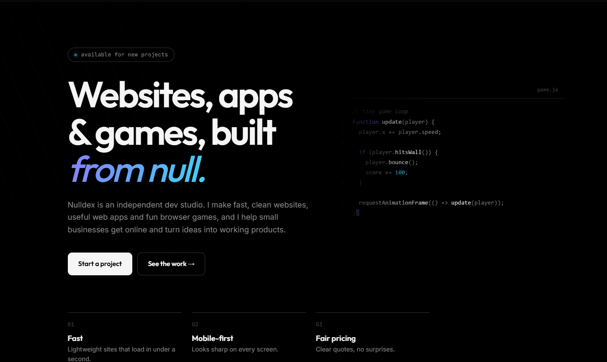

# nulldex.net

The website of **Nulldex**, an independent dev studio building websites, web apps and browser games.

**Live:** https://nulldex.net



## Highlights

- **No framework, no build step.** Plain HTML, CSS and JavaScript, about 30 KB of code.
- **A self-typing code editor** in the hero, with a small regex-based syntax highlighter (no libraries).
- **Monochrome design system** built from the logo, with one violet → cyan accent, driven by CSS custom properties.
- **Dark by default, optional light theme.** The visitor's choice is remembered and applied before first paint, so the page never flashes.
- **Self-hosted variable fonts** (Outfit, Inter, JetBrains Mono), preloaded so text doesn't shift while loading.
- **Respects `prefers-reduced-motion`.** Animations turn off for people who ask for less motion.
- **Mobile-first and responsive**, down to small phones.

## Hosting

- An Ubuntu VPS running **Caddy**, which handles automatic HTTPS, compression and security headers.
- **Cloudflare** for DNS and email routing.
- Deploys swap the old and new versions in one step, so visitors never see a half-updated site.

## Structure

```
index.html     page markup
style.css      design system + layout
script.js      theme toggle, typing animation, contact form
assets/        logo, icons, self-hosted fonts
```

## Run locally

Any static file server works:

```bash
npx serve .
```

---

© Nulldex. The code is here to read and learn from. The Nulldex name and logo are not licensed for reuse.
